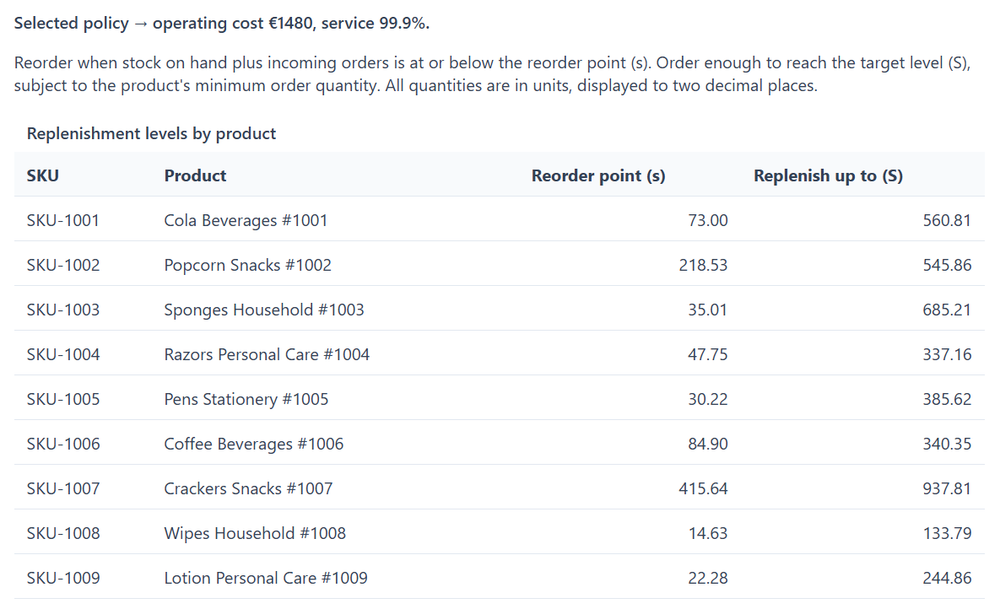

# Inventory Forecast AI

[](https://github.com/mrr97/inventory-forecast-ai/actions/workflows/ci.yml)
[](LICENSE)


Ordering stock means balancing two costly outcomes: keeping products on the shelf that do not sell, and running out of the ones customers want. Recent sales alone can be a poor guide when a promotion or seasonal change is approaching. Inventory Forecast AI uses sales history, the calendar and planned promotions to estimate demand for each product over the next 14 days, helping translate an expected change in sales into an ordering decision.

It then simulates different demand outcomes and compares rules for when to reorder and how much stock to replenish. The dashboard shows the resulting options alongside their estimated holding and ordering costs and the proportion of demand they can fulfil. This lets a planner weigh the cost of carrying more stock against the risk of missed sales. The project demonstrates the approach on a reproducible synthetic dataset, with comparisons against simpler forecasting and stock-planning methods.

## Demo

The Dash dashboard shows demand forecasts, evaluation results and a Pareto frontier: a set of ordering policies offering different balances between inventory cost and the proportion of demand served.

<table>
  <tr>
    <th width="50%">Cost vs. service</th>
    <th width="50%">Replenishment levels for a selected policy</th>
  </tr>
  <tr>
    <td valign="top">
      <a href="docs/pareto.png"></a>
    </td>
    <td valign="top">
      <a href="docs/replenishment.png"></a>
    </td>
  </tr>
</table>

## How it works

### Demand forecasting

A single CatBoost model predicts demand across all products and forecast horizons, using Poisson loss for unit counts. Each prediction combines recent sales with information available for the target day, including the calendar, planned promotions and prices. The horizon is an input feature, so each day is predicted directly without feeding earlier predictions back into the model.

The 14-day horizon covers the weekly review period plus lead time. A small temporal grid search selects tree depth and learning rate, while early stopping selects the number of iterations. Validation uses data preceding the backtest window. MLflow records the experiments, selected parameters and training curves in a local SQLite backend.

### Ordering policies

The forecasts become Monte Carlo demand scenarios, combining Poisson demand noise with forecast uncertainty estimated from the backtest for each horizon. The uncertainty adjustment accounts for Poisson noise already present in the samples.

The simulator evaluates `(s, S)` policies: place an order when stock falls below `s`, replenishing towards `S`. NSGA-II, implemented with pymoo, searches for policies that balance operating cost and service. A simulation-based optimizer fits this problem because service depends on non-linear stock and demand interactions. The resulting frontier contains policies for which neither objective can improve without worsening the other among the solutions found.

### Pipeline

Dagster connects data generation, training, optimization and evaluation:

```text
demo_data → trained_model → pareto_frontier ┐
        └→ forward_vs_trailing ─────────────┴→ scorecard
```

A weekly schedule is defined for Mondays at 06:00 (Europe/Madrid) and can be enabled in Dagster. The scorecard combines the outputs in `data/metrics/report.json`, which the dashboard reads.

## Results and limitations

The demo contains two years of daily sales for 22 fictional products across five categories. It includes weekly and yearly seasonality, promotions and Poisson noise, generated from a fixed seed. The results below come from the saved [evaluation report](data/metrics/report.json) on this synthetic dataset.

### Forecast accuracy

A rolling-origin backtest evaluates 14-day forecasts against a trailing 28-day mean, using only past observations at each forecast origin.

| Model | WAPE | MAE (units) |
|---|---:|---:|
| Trailing mean | 0.253 | 10.45 |
| CatBoost | 0.134 | 5.51 |

WAPE (total absolute error divided by total demand) is about 47% lower overall. On promotion days, it falls from 0.477 to 0.136, a reduction of about 71%.

### Optimized policies

On the simulated demand scenarios, the optimizer returns 52 non-dominated policies. Compared with a standard safety-stock policy costing €2,157 at 99.8% service, an optimized policy reduces operating cost by about 32% while matching or exceeding that service level.

Operating cost includes holding and ordering costs. Service is the proportion of demand fulfilled.

### Forecast-based ordering

A separate comparison uses the same `(s, S)` policy formula with either the forecast or the trailing mean as its demand estimate. Orders are simulated against the subsequent demand in an automatically selected seasonal window, with weekly forecast origins. Total cost includes operating cost and lost sales valued at unit margin.

| Demand estimate | Total cost | Service |
|---|---:|---:|
| Trailing mean | €3,385 | 98.3% |
| CatBoost forecast | €2,733 | 99.3% |

In this window, the forecast-based policy has about 19% lower total cost and serves roughly one percentage point more demand. The trailing-mean policy loses around 2.5 times as many sales.

These comparisons have different scopes: optimization measures operating cost on sampled scenarios; the seasonal comparison measures total cost against subsequent demand. Neither demonstrates savings on real inventory data. The seasonal comparison covers one selected window rather than a full policy backtest, and the demand scenarios treat forecast horizons as independent, leaving sustained demand patterns unmodelled.

## Quickstart

With Docker Compose installed:

```bash
docker compose up
```

The pipeline generates the demo data, trains the model, runs both policy comparisons and builds the scorecard. The dashboard starts after the pipeline finishes.

- Dashboard: http://localhost:8050
- Dagster: http://localhost:3000

### Local development and CLI

With Python 3.12 and uv installed:

```bash
uv sync --dev
uv run inventory-forecast-ai pipeline
uv run inventory-forecast-ai dashboard
```

To run individual parts:

```bash
uv run inventory-forecast-ai generate-demo  # write data/skus.csv and data/demand.csv
uv run inventory-forecast-ai train          # backtest, log experiments and save the model
uv run inventory-forecast-ai optimize       # simulate policies and save the Pareto frontier
uv run inventory-forecast-ai compare        # compare demand estimates on the seasonal window
uv run inventory-forecast-ai metrics        # consolidate the evaluation report
uv run dagster dev                         # inspect the asset graph and enable the schedule
```

Configuration options are listed in [.env.example](.env.example). Defaults work without an `.env` file for the demo. Training runs on CPU by default; local CUDA training can be selected with `CATBOOST_TASK_TYPE=GPU` on a compatible setup. GPU training may produce slightly different results between runs.

## Technologies and development

Python 3.12 · CatBoost · MLflow · pymoo / NSGA-II · Dagster · Dash / Plotly · Pydantic · structlog · Docker Compose

```bash
uv run pytest
uv run ruff check .
uv run ruff format --check .
```

## Resumen en español

Proyecto de predicción de demanda y planificación de inventario. Un modelo CatBoost estima la demanda de los próximos 14 días con información de ventas, calendario y promociones. La simulación y la optimización multiobjetivo permiten comparar políticas de pedido según coste y nivel de servicio. Incluye un dashboard y un pipeline con Dagster; la evaluación utiliza datos sintéticos.

## License

MIT.
