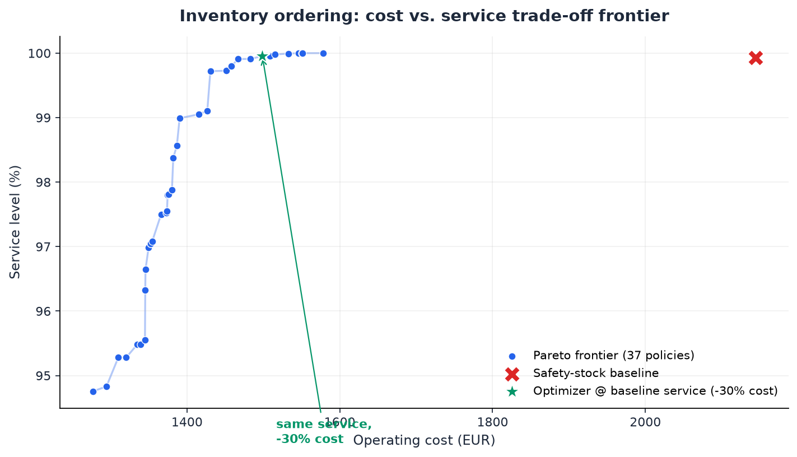

# Inventory Forecast AI

> Forecast the days ahead, then explore the **cost-vs-service trade-off frontier** to decide how much to order.

[](https://github.com/mrr97/inventory-forecast-ai/actions/workflows/ci.yml)
[](LICENSE)


A demand-to-decision pipeline that plans inventory by **looking forward**, not backward. A single
multi-horizon model forecasts the next two weeks of demand for every SKU — using the calendar and
**planned promotions** — and those forecasts drive the ordering policy.

- **Forecast (forward vs. a trailing-mean baseline):** cuts demand error (WAPE) **~47%** overall and **~71% on promotion days**, where a backward-looking mean is blind.
- **Decision (on the most seasonal stretch):** planning ahead cuts **total inventory cost ~19%** at **higher service** — the retrovisor loses ~2.5× more sales.
- **Optimization:** at the safety-stock baseline's service level, the optimizer cuts operating cost **~32%**, and returns a whole **Pareto frontier** to pick from rather than a single number.



---

## Quickstart (Docker)

One command builds the whole pipeline and serves the dashboards — no local Python needed:

```bash
docker compose up
```

- **Dashboard** → http://localhost:8050 — scorecard, forward demand forecast, and the Pareto frontier
- **Dagster UI** → http://localhost:3000 — the asset graph and the weekly recompute schedule

The `pipeline` service runs the full asset graph first (generate demo data → train → optimize →
compare → scorecard); the dashboard starts once it finishes. To run locally instead, see the
per-step commands below.

## Why look forward?

Setting stock levels from the **recent past** — a trailing mean — is like driving by the rear-view
mirror: fine on a straight road, but it lags every curve. Seasonality, trends and **promotions** are
exactly the curves, and they are *knowable in advance*. This project forecasts each of the next
`HORIZON` days explicitly (calendar + planned promo/price), so the ordering policy **anticipates**
demand instead of chasing it. The payoff shows up precisely where the trailing mean is blind — see
the promotion-day and seasonal-stretch numbers below.

## What it does

1. **Forecast demand** up to two weeks ahead with a single global [CatBoost](https://catboost.ai/) model, benchmarked against a trailing-mean baseline with a rolling-origin backtest.
2. **Track experiments** with MLflow (local SQLite backend, no server).
3. **Turn the forecast into demand scenarios**, widened by the *measured* per-horizon forecast error, so the optimizer provisions for real uncertainty.
4. **Optimize ordering policies** with a **multi-objective metaheuristic** ([pymoo](https://pymoo.org/), NSGA-II) → a **Pareto frontier** of cost vs. service.
5. **Prove the decisions are better** with a forward-vs-trailing comparison at the cost level on the most seasonal stretch.
6. **Visualize** the forecast, the frontier and a scorecard in a Dash dashboard.
7. **Orchestrate** the pipeline with a Dagster asset graph and a **weekly recompute** schedule.

## Demo dataset

Two years of daily sales for ~22 fictional SKUs across five categories, with weekly and yearly
seasonality, price promotions, and Poisson noise — fully reproducible from a single seed.

```bash
uv sync --dev
uv run inventory-forecast-ai generate-demo
# -> data/skus.csv      (SKU master + economics)
# -> data/demand.csv    (daily units_sold, on_promo, price)
```

## Forecasting

A single **global CatBoost** model (Poisson loss for count demand) forecasts every horizon at once
by taking the **horizon `h` as an input feature** — so one model, queried for `h = 1..14`, produces
the whole forward path (no recursion, so error does not compound). Each row pairs **origin-time**
features (recent demand as-of today) with **target-day** features knowable in advance (calendar and
*planned* promo/price). The horizon `HORIZON = 14` is the **protection interval** = weekly review +
lead time. Hyperparameters are **not hand-tuned constants**: the number of boosting iterations is
chosen by **early stopping** on a temporal validation tail (the most recent weeks of history, so
`iterations` is only a ceiling), and `depth` / `learning_rate` come from a **small temporal grid
search** on that same tail — a sanity check on the defaults, run on pre-holdout data so it never
sees the backtest window. The selected iteration count, the search trials and CatBoost's own
training-progress chart are all logged to MLflow.

It is scored with a **rolling-origin backtest** — train on the past, roll the origin through a
held-out tail, score the full 14-day path per horizon — against the **trailing 28-day mean**
(the retrovisor):

```bash
uv run inventory-forecast-ai train       # rolling-origin backtest + MLflow + save model
```

| Model | WAPE | MAE |
|-------|-----:|----:|
| trailing mean (retrovisor) | 0.253 | 10.45 |
| **forward (this model)** | **0.134** | **5.51** |

→ **~47% lower WAPE overall, and ~71% lower on promotion days** (0.136 vs. 0.477), where a
backward-looking mean cannot see the spike coming.

> **Scaling note.** Training runs on **CPU** by default: portable (runs anywhere with
> `docker compose up`) and **deterministic** — the figures above reproduce from the seed. For very
> large catalogues set `CATBOOST_TASK_TYPE=GPU` and CatBoost trains on CUDA with no other code
> change; note that GPU training is not bit-for-bit reproducible, so exact figures then vary
> slightly run-to-run.

## Scenarios & uncertainty

Each **(s, S) ordering policy** (reorder point `s`, order-up-to level `S`) is scored by **simulating**
it over Monte-Carlo demand sampled around the **forward** forecast. The samples carry two uncertainty
sources: the Poisson count noise, and the model's own forecast error — widened per horizon by the
**measured** backtest error (net of Poisson noise), so scenarios are neither over-confident nor
double-counting.

## Optimization & dashboard

NSGA-II evolves a population of policies and returns the **Pareto frontier** of operating cost vs.
service level, benchmarked against a textbook safety-stock baseline.

```bash
uv run inventory-forecast-ai optimize    # build + save the Pareto frontier
uv run inventory-forecast-ai dashboard   # serve forecast + Pareto views (http://127.0.0.1:8050)
```

| Policy | Operating cost | Service |
|--------|---------------:|--------:|
| baseline (safety stock) | €2157 | 99.8% |
| optimizer @ baseline service | **−32%** | 99.8% |

→ The frontier holds **52 non-dominated policies**; the business picks the cost/service trade-off it
wants rather than being handed a single number.

### Why a metaheuristic instead of an exact solver?

Service level is measured by **simulation** over forecasted demand scenarios; it is non-linear and
effectively black-box, which breaks a clean linear program and genuinely justifies a population-based
multi-objective optimizer. The deliverable is a frontier the business can choose from.

## Does looking forward actually cost less? (decision-level proof)

Accuracy is not the point — **better decisions** are. On the **most seasonal stretch** of the data
(auto-selected), the origin is rolled weekly and the *same* textbook (s, S) policy is built two ways
— fed the **forward forecast** vs. the flat **trailing mean** — then both are simulated against the
**actual** demand that followed. The headline is **total economic cost** = operating cost **plus lost
sales valued at unit margin** (the honest newsvendor view: understocking only looks cheap because it
fails to serve demand).

```bash
uv run inventory-forecast-ai compare     # forward vs. trailing on the seasonal stretch
```

| Policy | Total cost | Service |
|--------|-----------:|--------:|
| trailing mean (retrovisor) | €3385 | 98.3% |
| **forward (parabrisas)** | **€2733** | 99.3% |

→ **~19% lower total cost at ~1 pp higher service.** The trailing policy's operating cost is barely
lower, but it loses **~2.5× more sales** because it lags the ramp — so it ends up more expensive.

## Scorecard

A single reproducible **scorecard** consolidates all three halves. `train`, `optimize` and `compare`
each persist their metrics, and `metrics` merges them into `data/metrics/report.json` — the artifact
the dashboard's *Scorecard* tab reads and this README cites.

```bash
uv run inventory-forecast-ai metrics     # build data/metrics/report.json
```

## Orchestration (Dagster)

The stages are wired as a **software-defined asset graph**, so the pipeline is a dependency DAG
rather than a script, with a **weekly recompute** schedule (Mondays) that refreshes the policies with
a fresh forecast:

```
demo_data → trained_model → pareto_frontier ┐
        └→ forward_vs_trailing ─────────────┴→ scorecard
```

```bash
uv run inventory-forecast-ai pipeline    # materialize the full graph in order
uv run dagster dev                       # asset graph + schedule (http://localhost:3000)
```

## Project layout

```
src/inventory_forecast_ai/
  config.py        # Pydantic settings (.env)
  log.py           # structlog setup
  models.py        # typed domain models (Sku, Category)
  demo/generator.py# deterministic synthetic data
  forecasting/     # multi-horizon features, CatBoost model, rolling-origin backtest
  optimization/    # forward demand scenarios, (s,S) simulator, NSGA-II, Pareto frontier
  evaluation/      # scorecard + decision-level forward-vs-trailing comparison
  orchestration/   # Dagster asset graph + weekly schedule
  ui/              # Dash dashboard (scorecard + forecast + Pareto views)
  cli.py           # typer CLI
tests/             # pytest
```

## Notes & limitations

- The demand is synthetic but *learnable* (seasonality + promotions + Poisson noise); the point is
  the method, not the numbers, which will differ on real data.
- The seasonal-stretch comparison is deliberately scoped to one auto-selected window; it is a proof
  of mechanism, not a full backtest of the ordering policy.
- Scenario widening treats horizons as independent given the forecast; sustained demand *streaks*
  (temporal correlation) are left as a documented next step (e.g. block-bootstrap residuals).

---

## Resumen (ES)

Pipeline de planificación de inventario que decide **mirando hacia delante**, no hacia atrás. Un
único modelo multi-horizonte (CatBoost, horizonte como variable) predice los próximos 14 días de
demanda por SKU usando el calendario y las **promociones planificadas**, y esa predicción alimenta la
política de pedido (s, S). Frente a una **media móvil** (el "retrovisor"): **~47% menos error (WAPE)**,
**~71% menos en días de promoción**, y en el tramo más estacional **~19% menos coste total** con más
servicio (el retrovisor pierde ~2,5× más ventas). La optimización multi-objetivo (pymoo / NSGA-II)
sobre escenarios de demanda **futura** —ensanchados por el error de pronóstico medido— entrega una
**frontera de Pareto** coste-vs-servicio, no un único número. Todo se encadena con un grafo de assets
de **Dagster** con **recálculo semanal**, y se levanta con `docker compose up`.

## Licencia

MIT
